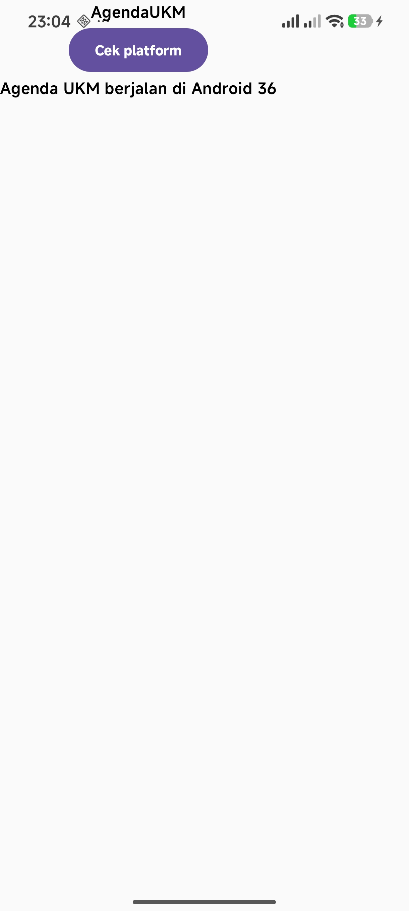

# pam-tema9-agenda-ukm

## Nomor & Nama Tema
- **Nomor tema:** 9
- **Nama tema:** Agenda kegiatan UKM

## Nama dan NIM Anggota Kelompok
- Arsa Salsabila (NIM 123140108) - Ketua
- Habbi Widagdo (NIM 123140204)
- Afifa Aulia (NIM 123140073)
- Najlatika (NIM 123140078)

## Praktikum 1

Tugas Praktikum Minggu 1 mencakup implementasi dasar Kotlin Multiplatform (KMP) dengan ketentuan sebagai berikut:
- **Judul Aplikasi:** Mengubah nama/judul aplikasi menjadi nama tema, yaitu **AgendaUKM**.
- **Implementasi Expect & Actual:** Menampilkan nama platform secara dinamis menggunakan mekanisme `expect` dan `actual` untuk memanggil informasi spesifik platform.
- **Multi-Platform Support:** Aplikasi berhasil dijalankan dan dites pada 2 platform target:
    1. **Desktop (JVM)**
    2. **Android**

### Hasil Pengujian Aplikasi

| Tampilan Aplikasi di Desktop | Tampilan Aplikasi di Android | 
|:----------------------------:|:----------------------------:| 
|      |       | 