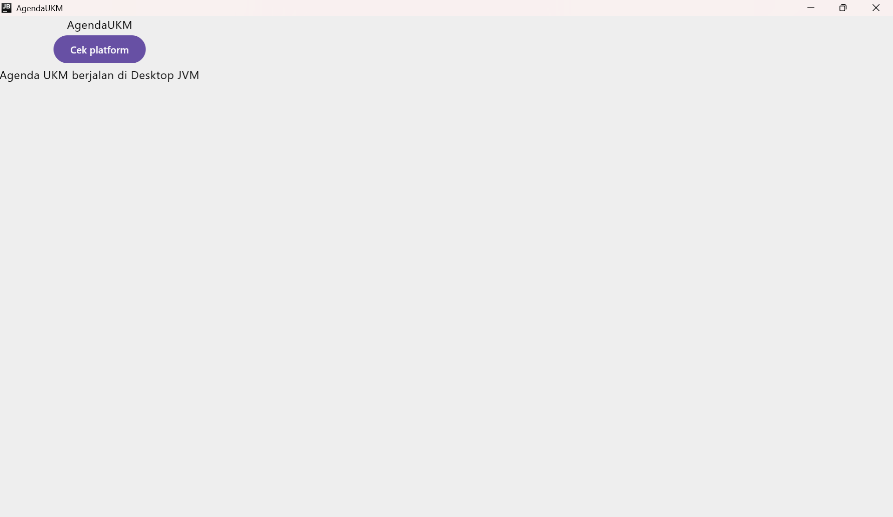

# pam-tema9-agenda-ukm

## Nomor & Nama Tema
- **Nomor tema:** 9
- **Nama tema:** Agenda kegiatan UKM

## Nama dan NIM Anggota Kelompok
- Arsa Salsabila (NIM 123140108) - Ketua
- Habbi Widagdo (NIM 123140204)
- Afifa Aulia (NIM 123140073)
- Najlatika (NIM 123140078)

## Praktikum 1

Tugas Praktikum Minggu 1 mencakup implementasi dasar Kotlin Multiplatform (KMP) dengan ketentuan sebagai berikut:
- **Judul Aplikasi:** Mengubah nama/judul aplikasi menjadi nama tema, yaitu **AgendaUKM**.
- **Implementasi Expect & Actual:** Menampilkan nama platform secara dinamis menggunakan mekanisme `expect` dan `actual` untuk memanggil informasi spesifik platform.
- **Multi-Platform Support:** Aplikasi berhasil dijalankan dan dites pada 2 platform target:
    1. **Desktop (JVM)**
    2. **Android**

### Hasil Pengujian Aplikasi

| Tampilan Aplikasi di Desktop | Tampilan Aplikasi di Android | 
|:----------------------------:|:----------------------------:| 
|      |       | 

## Praktikum 2

Tugas Praktikum Minggu 2 mencakup penerapan Kotlin dasar lanjutan, data class, null safety, extension function, serta pengolahan data menggunakan Coroutines dan Flow.

- **Data Class:** Membuat dan mengelola data UKM serta kegiatan menggunakan `data class`.
- **Copy dan Null Safety:** Menggunakan fungsi `copy()` untuk membuat objek baru dan menangani nilai `null`.
- **Extension Function:** Menggunakan fungsi `label()` untuk membaca status kegiatan dan `ringkas()` untuk menghasilkan ringkasan kegiatan.
- **Coroutines dan Flow:** Menggunakan operator `filter`, `map`, dan `collect` untuk memantau serta mengolah data kegiatan.
- **Pengujian:** Menjalankan pengujian pada target JVM (Desktop) untuk memeriksa hasil implementasi.

### Hasil Pengujian Aplikasi

**Tampilan Aplikasi di Desktop**


**Tampilan Aplikasi di Android**


### Hasil Pengujian Coroutines dan Flow

Pengujian dilakukan menggunakan Coroutines dan Flow untuk memantau perubahan status kegiatan. Operator `filter` digunakan untuk menyaring data kegiatan, `map` untuk mengubah data menjadi ringkasan, dan `collect` untuk menerima hasil aliran data.

### Pembagian Tugas Kelompok

| No. | Nama Anggota | Tugas |
|---|---|---|
| 1 | Afifa Aulia | Membuat data class `Kegiatan`, `UKM`, dan `StatusKegiatan`. |
| 2 | Arsa Salsabila | Membuat extension function `label()` dan `ringkas()`, serta menguji `copy()` dan null safety. |
| 3 | Habbi Widagdo | Membuat sumber data kegiatan menggunakan Coroutines dan Flow. |
| 4 | Najlatika | Menguji pengolahan data menggunakan `runBlocking`, `filter`, `map`, dan `collect`, serta menyusun dokumentasi README. |

**Output Pengujian:**

```text
Diterima dari Flow: #1 Latihan Rutin Basket | PJ: Joko
Jadwal: 10 Oktober 2026 (19:00 WIB - 21:00 WIB)
|Lokasi: GOR ITERA
Info: Latihan mingguan persiapan rekrutmen (Ada deskripsi? true)

Diterima dari Flow: #1 Latihan Rutin Basket | PJ: Joko
Jadwal: 10 Oktober 2026 (19:00 WIB - 21:00 WIB)
|Lokasi: GOR ITERA
Info: Latihan mingguan persiapan rekrutmen (Ada deskripsi? true)
```

**Status Pengujian:** Berhasil   1 pengujian dijalankan, 0 gagal, dan 0 error.


