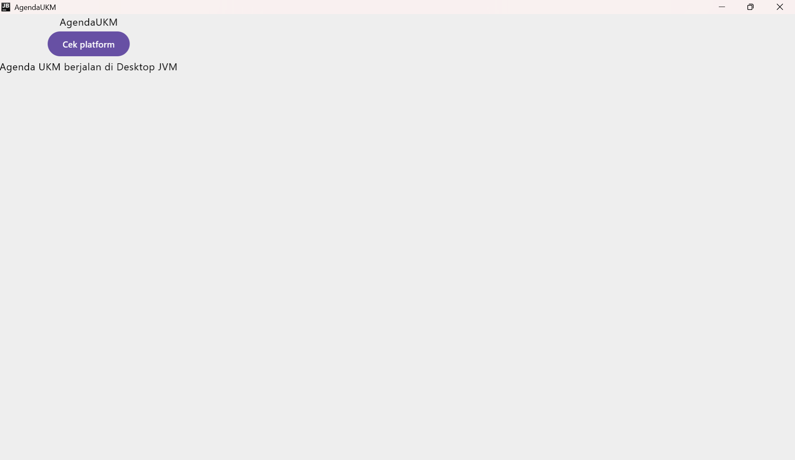
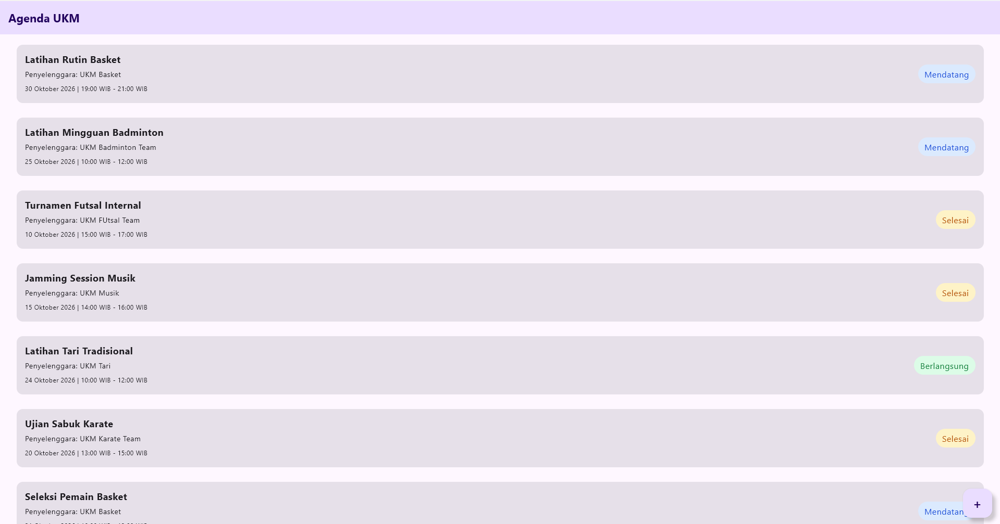
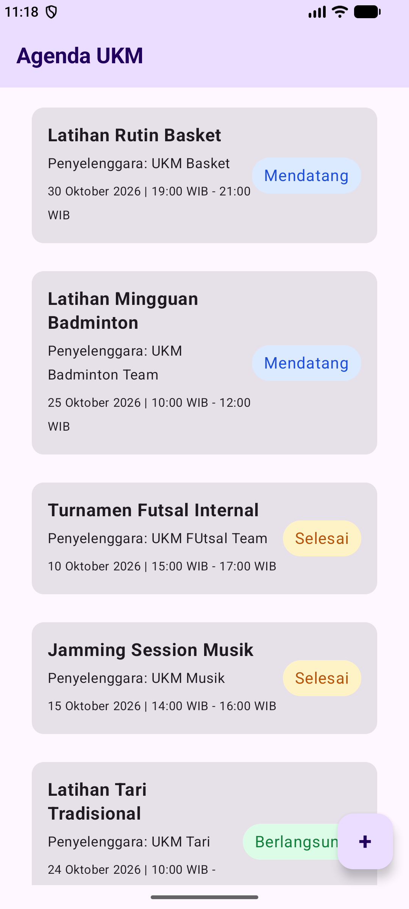

# pam-tema9-agenda-ukm

## Nomor & Nama Tema
- **Nomor tema:** 9
- **Nama tema:** Agenda kegiatan UKM

## Nama dan NIM Anggota Kelompok
- Arsa Salsabila (NIM 123140108) - Ketua
- Habbi Widagdo (NIM 123140204)
- Afifa Aulia (NIM 123140073)
- Najlatika (NIM 123140078)

## Praktikum 1

Tugas Praktikum Minggu 1 mencakup implementasi dasar Kotlin Multiplatform (KMP) dengan ketentuan sebagai berikut:
- **Judul Aplikasi:** Mengubah nama/judul aplikasi menjadi nama tema, yaitu **AgendaUKM**.
- **Implementasi Expect & Actual:** Menampilkan nama platform secara dinamis menggunakan mekanisme `expect` dan `actual` untuk memanggil informasi spesifik platform.
- **Multi-Platform Support:** Aplikasi berhasil dijalankan dan dites pada 2 platform target:
    1. **Desktop (JVM)**
    2. **Android**

### Hasil Pengujian Aplikasi

| Tampilan Aplikasi di Desktop | Tampilan Aplikasi di Android | 
|:----------------------------:|:----------------------------:| 
|      |       | 

## Praktikum 2

Tugas Praktikum Minggu 2 mencakup penerapan Kotlin dasar lanjutan, data class, null safety, extension function, serta pengolahan data menggunakan Coroutines dan Flow.

- **Data Class:** Membuat dan mengelola data UKM serta kegiatan menggunakan `data class`.
- **Copy dan Null Safety:** Menggunakan fungsi `copy()` untuk membuat objek baru dan menangani nilai `null`.
- **Extension Function:** Menggunakan fungsi `label()` untuk membaca status kegiatan dan `ringkas()` untuk menghasilkan ringkasan kegiatan.
- **Coroutines dan Flow:** Menggunakan operator `filter`, `map`, dan `collect` untuk memantau serta mengolah data kegiatan.
- **Pengujian:** Menjalankan pengujian pada target JVM (Desktop) untuk memeriksa hasil implementasi.

### Hasil Pengujian Aplikasi

**Tampilan Aplikasi di Desktop**


**Tampilan Aplikasi di Android**


### Hasil Pengujian Coroutines dan Flow

Pengujian dilakukan menggunakan Coroutines dan Flow untuk memantau perubahan status kegiatan. Operator `filter` digunakan untuk menyaring data kegiatan, `map` untuk mengubah data menjadi ringkasan, dan `collect` untuk menerima hasil aliran data.

### Pembagian Tugas Kelompok

| No. | Nama Anggota | Tugas |
|---|---|---|
| 1 | Afifa Aulia | Membuat data class `Kegiatan`, `UKM`, dan `StatusKegiatan`. |
| 2 | Arsa Salsabila | Membuat extension function `label()` dan `ringkas()`, serta menguji `copy()` dan null safety. |
| 3 | Habbi Widagdo | Membuat sumber data kegiatan menggunakan Coroutines dan Flow. |
| 4 | Najlatika | Menguji pengolahan data menggunakan `runBlocking`, `filter`, `map`, dan `collect`, serta menyusun dokumentasi README. |

**Output Pengujian:**

```text
Diterima dari Flow: #1 Latihan Rutin Basket | PJ: Joko
Jadwal: 10 Oktober 2026 (19:00 WIB - 21:00 WIB)
|Lokasi: GOR ITERA
Info: Latihan mingguan persiapan rekrutmen (Ada deskripsi? true)

Diterima dari Flow: #1 Latihan Rutin Basket | PJ: Joko
Jadwal: 10 Oktober 2026 (19:00 WIB - 21:00 WIB)
|Lokasi: GOR ITERA
Info: Latihan mingguan persiapan rekrutmen (Ada deskripsi? true)
```

**Status Pengujian:** Berhasil   1 pengujian dijalankan, 0 gagal, dan 0 error.

## Praktikum 3

Praktikum 3 mengimplementasikan antarmuka Agenda UKM dengan Compose Multiplatform berdasarkan pembagian tugas kelompok. Aplikasi menampilkan daftar kegiatan yang disediakan oleh `SumberKegiatanPalsu`, lengkap dengan nama kegiatan, UKM penyelenggara, jadwal, dan label status.

- **Label status:** Menampilkan `StatusKegiatan` dari Modul 2 sebagai badge berwarna dengan latar dan sudut membulat.
- **Pengolahan koleksi:** Menyediakan filter kegiatan berdasarkan status melalui extension function `filterByStatus`.
- **Kartu kegiatan:** Menampilkan informasi kegiatan dan status dalam kartu yang dapat merespons ketukan.
- **Daftar kegiatan:** Menampilkan data menggunakan `LazyColumn`, `items()`, dan key berdasarkan ID kegiatan.
- **Layar utama:** Menyusun header, daftar kegiatan, dan FloatingActionButton (FAB) dalam `Scaffold`. FAB saat ini hanya menjadi elemen kerangka antarmuka dan belum menjalankan aksi tambah kegiatan.
- **Pengujian:** Menjalankan pengujian mekanisme filter dan uji tampilan pada Desktop (JVM) serta Android.

### Hasil Pengujian Antarmuka

**Tampilan Aplikasi di Desktop**



**Tampilan Aplikasi di Android**



### Hasil Pengujian Mekanisme Filter Kegiatan

Pengujian dilakukan pada target JVM melalui `:shared:jvmTest` dan berhasil. Analisis kode menunjukkan dua mekanisme filter yang diuji:

1. Pada `testPantauKegiatanDenganFlowOperator`, Flow `pantau(id = 1)` memancarkan kegiatan dengan status Mendatang, Berlangsung, lalu Selesai. Operator `filter` membuang emisi berstatus Mendatang, `map` mengubah dua emisi yang tersisa menjadi ringkasan melalui `ringkas()`, dan `collect` mengumpulkan hasilnya. Pengujian memastikan ada dua hasil dan ringkasan memuat nama kegiatan yang diharapkan.
2. Pada `testFilterKegiatanBerdasarkanStatus`, extension function `filterByStatus(StatusKegiatan.Mendatang)` memilih hanya kegiatan yang statusnya sama persis dengan status yang diminta. Pengujian memastikan satu kegiatan terpilih dan statusnya Mendatang.

Filter berdasarkan status tersebut merupakan fungsi pengolahan koleksi yang tersedia dan diuji; layar utama saat ini masih menampilkan seluruh daftar kegiatan dan belum menyediakan kontrol filter interaktif.

### Pembagian Tugas Kelompok

#### Tugas 1 — Najlatika
- Membuat `LabelStatus.kt` untuk memvisualisasikan badge/pil dari `StatusKegiatan` menggunakan background dan `RoundedCornerShape`.
- Membuat fungsi pengolahan koleksi kegiatan berupa logika filter atau sorting. Implementasi saat ini menyediakan `filterByStatus` untuk menyaring kegiatan berdasarkan status.

#### Tugas 2 — Afifa Aulia
- Membuat `KartuKegiatan.kt`, komponen `Card` untuk menampilkan entitas `Kegiatan` beserta nama UKM dan label `StatusKegiatan` dari Modul 2, menggunakan layout `Row`, `Column`, dan `weight`.
- Menerapkan event handler lambda `onKlik: () -> Unit` agar kartu merespons ketukan.

#### Tugas 3 — Arsa Salsabila
- Memperbarui `SumberKegiatanPalsu.kt` dengan minimal 10 data dummy kegiatan yang memiliki variasi status dan UKM. Implementasi saat ini menyediakan 11 kegiatan.
- Membuat `DaftarKegiatan.kt` menggunakan `LazyColumn` dan `items()` dengan key ID untuk menampilkan daftar kartu secara efisien.

#### Tugas 4 — Habbi Widagdo
- Membuat `LayarUtama.kt` yang menyusun layar menggunakan `Scaffold`, header judul, dan FAB sebagai elemen kerangka antarmuka.
- Menghubungkan `LayarUtama` ke `App.kt`, menguji tampilan pada Desktop dan Android, serta memperbarui README dengan tangkapan layar UI.
